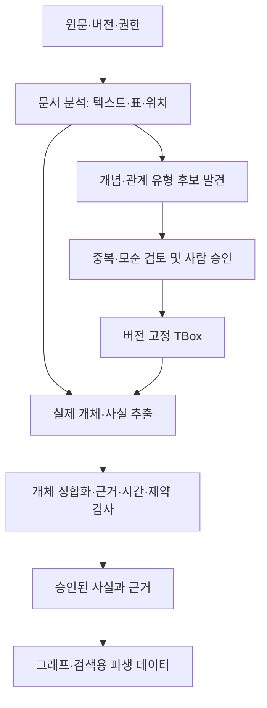

# Azure Ontology Lab: 방법론과 실행 계획

## 1. 목적과 현재 상태

비정형 문서와 정형 데이터를 업무 개념으로 연결하고, Azure/Microsoft 구성 요소로 구축·평가·운영하는 방법을 팀이 재현할 수 있게 설명합니다. 최종 산출물은 개념 가이드, 실행 가능한 실험, 근거가 있는 비교 보고서, 운영 절차입니다.

이 문서는 2026-11-04 다중 모델 검토와 2026-11-06까지의 사용자 결정을 반영한 **설계안**입니다. 구현 완료 보고서나 운영 적합성 인증이 아닙니다. 개발 단계와 승인 상태는 [개발 계획](development-plan.md)에 정리합니다. 제품 관련 출처는 아래에 연결했으며, 실제 배포 시 API·버전·지역별로 다시 확인해야 합니다.

### 확정·제안·미확정 구분

| 상태 | 내용 |
|---|---|
| 사용자 확정 | 문서에서 온톨로지를 만드는 과정까지 포함 |
| 사용자 확정 | Azure/Microsoft 관리형 운영을 우선하고 직접 구현 부분을 명시 |
| 사용자 확정 | 네이티브 RAG, Fabric Graph RAG, HorizonDB Graph RAG, Microsoft GraphRAG 모두 구현·비교 대상 |
| 사용자 확정 | TBox·ABox·근거·개체 정합화·질의·답변·운영 평가 유지 |
| 사용자 확정 | 실제 업무에 가까운 공개 문서 조사, 팀 공유용 자세한 가이드·결과 보고서 |
| 사용자 확정 | 저장소명 `azure-ontology-lab`, GPT·Claude·Gemini·Grok을 포함한 최소 5개 에이전트의 독립·상호 검토 |
| 사용자 확정 | E1 발견·E2 스키마 제공 추출·E3 통제 비교·E4 전체 구성 비교 분리. E3 최소 한 쌍, N의 E1·E2는 N/A |
| 확정 | 계약 문서를 주 시나리오로, 금융 PDF(FinanceBench)를 처음부터 포함. 단 금융은 별도 시나리오로 보고하며 점수를 합산하지 않음. 권리·표본 검사 통과가 선행 조건 |
| 검토 대기 | 합성 정형 테이블 연결 시험, 평가 세부 방식, 운영 수용 시험, gate·승인 역할의 세부안 |
| 미확정 | 최종 데이터셋·샘플 수·평가 분할·주 지표·통과 기준·비용 한도 |
| 미확정 | Azure 구독·Fabric 용량·지역·모델 배포·Preview 허용·사람 검토 담당자 |

이전의 가상 문서 60개·질문 100개와 DWIE 주 데이터 제안은 확정된 요구가 아닙니다. 새로운 합의는 이 표와 관련 절차에 함께 반영합니다.

저장소명 선택은 확정됐으나 원격 변경은 GitHub HTTP 403으로 차단됐습니다. 본 문서의 프로젝트명과 실제 원격 저장소명이 다를 수 있습니다. 다중 모델 검토의 실행 범위와 의견 충돌은 [검토 보고서](methodology-review.md)에 기록합니다.

## 2. 개념: 온톨로지와 Graph RAG는 같은 것이 아닙니다

| 개념 | 의미 | 예시 |
|---|---|---|
| TBox | 클래스·계층·속성·관계와 지원하는 논리 공리 | 계약, 당사자, 의무, 계약의 당사자 관계 |
| ABox | 특정 개체에 대한 사실 주장 | 계약 C의 당사자는 회사 A |
| RBox | 별도로 구분할 경우 관계의 역관계·추이성·합성 등의 공리 | 소속 관계의 역관계 정의 |
| 지식 그래프 | 개체와 관계로 표현한 지식 | 계약 C와 회사 A의 연결 |
| Graph RAG | 그래프의 관계 문맥을 답변 검색에 활용하는 패턴 | 계약에서 의무와 예외를 따라가 근거 조회 |
| Microsoft GraphRAG | 개체·관계·커뮤니티·요약을 이용하는 특정 오픈소스 구현 | Local, Global, DRIFT 검색 |

일반 그래프 탐색은 OWL 논리 추론과 같지 않습니다. TBox/ABox라는 구분을 적용해도 모든 구현이 RDF/OWL을 지원하는 것은 아닙니다. 각 구현의 의미 표현 범위를 명시합니다.

OWL의 개방 세계 가정에서는 누락된 사실이 곧 거짓은 아닙니다. 필수값·자료형·개수 검사는 별도의 데이터 제약 검사입니다. RDF에서는 SHACL 등을 사용할 수 있고, 다른 저장소에서는 동등한 목적의 코드·쿼리 검사를 구현합니다. 서로를 완전한 의미적 대체물이라고 주장하지 않습니다.

## 3. 문서에서 온톨로지를 만드는 방법

### 서비스와 직접 구현의 경계

| 단계 | 구성 후보 | 직접 구현·검토 책임 |
|---|---|---|
| 문서 읽기 | Content Understanding | 분석기 스키마, 파일 오류·표·OCR 평가 |
| 문서 기반 TBox 후보 | Azure에서 제공하는 LLM | 프롬프트, 후보 통합, 의미 정리, 전문가 승인 |
| Fabric 설계 보조 | Ontology agent | 첨부 문맥과 대량 적재 구분, 적용 전 검토 |
| ABox 추출 | 스키마 지정 문서 분석·LLM 또는 HorizonDB AI Functions | 관계 의미, 근거, 식별·정합화, 오류 처리 |
| 저장·조회 | OneLake/Fabric Graph, HorizonDB, GraphRAG 산출물 | 모델 매핑, 인덱스·버전·권한 관리 |
| 실행·관측 | Container Apps Jobs 또는 Fabric 실행 환경 등 | 작업 연결, 재시도, 배포, 품질 차단 |

Content Understanding은 지정 스키마의 정보 추출에도 사용할 수 있습니다. 단순 OCR·청킹만 하는 도구로 한정하지 않습니다. 반대로 범용 교차 문서 개체 정합화와 온톨로지 관리가 자동 제공된다고 가정하지도 않습니다.

Fabric Ontology agent의 문서 첨부는 설계 보조 기능입니다. 대량 문서의 지속적 ABox 적재와 동일하지 않습니다. HorizonDB의 개체·관계 추출 역시 공통 업무 TBox의 발견·승인을 자동으로 완성하는 기능으로 취급하지 않습니다.

### 계약 지식의 표현

의무를 단순한 긍정 엣지로 축약하지 않습니다. 의무 주체·대상·조건·예외·금지/허용/의무 구분·유효기간·출처를 표현할 수 있어야 합니다. 당사자 역할은 계약별로 구분하고, 회사 이름이 같다는 이유만으로 동일 개체로 합치지 않습니다.

주장과 근거는 분리합니다. 하나의 관계에 여러 근거가 연결될 수 있습니다. 문서 하나를 삭제하면 해당 근거와 파생 데이터를 무효화하되, 다른 유효 근거가 남은 관계까지 무조건 삭제하지 않습니다.

충돌 주장은 출처별로 보존합니다. 구체적인 우선순위 근거 없이 최신 파일이라는 이유만으로 법적 효력까지 확정하지 않습니다.

### 최소 의미 모델과 실행 가능한 질문

다음은 계약 시나리오를 선택할 경우의 최소 모델 **제안**입니다. 법률 온톨로지 전체를 새로 만드는 범위가 아닙니다.

| 객체 | 최소 필드·규칙 |
|---|---|
| 문서·근거 | 원천 ID, 문서 버전·해시, 좌표계, 위치, 접근 정책 |
| 당사자 역할 | 계약 범위 역할 ID와 회사 후보 ID를 분리. 역할·동일 회사 여부를 각각 검토 |
| 의무·허용·금지 주장 | 주장 ID, 계약, 주체 역할, 행위·대상, 양상, 조건, 예외, 효력 시간, 근거 ID 집합 |
| 시간 | 문서 버전 시점, 수집 시점, 주장된 효력 시간을 구분. 알 수 없는 효력은 미상으로 보존 |
| 연결 | 예외는 해당 의무에만 연결. 동일 이름만으로 회사 병합 금지. 개체·주장 ID는 표시 이름과 독립 |

저장소마다 노드·엣지의 물리적 표현은 달라도 됩니다. 평가는 공통 의미 슬롯과 근거 집합으로 투영하며, 저장소 내부 경로 문자열이 같아야 한다고 요구하지 않습니다.

역량 질문(CQ)마다 `cq_id`, 목적(E1 개념 포괄성/E2 사실 구성/E3·E4 조회), 입력 파라미터, 기대 답·바인딩, 필수 근거, 허용 대체 근거, unknown 조건, 적용 구성을 고정합니다. 개념 포괄성과 구체 사실 질의의 점수는 분리합니다. 백엔드별 질의나 어댑터는 달라도 되며, 없는 사실을 false로 바꾸지 않습니다.

최소 수용 사례는 다음과 같습니다. 실제 계약 정답이 아니라 작성할 시험의 명세입니다.

| 사례 | 확인할 결과 |
|---|---|
| 의무 하나에만 붙은 예외 | 다른 의무까지 예외 적용하지 않음 |
| 조건의 성립 여부가 문서에 없음 | 이행 의무의 확정 판단 대신 unknown·근거 한계를 반환 |
| 효력 시점과 업로드 순서가 다름 | as-of 질의가 근거 없는 최신 파일 우선순위를 사용하지 않음 |
| 같은 주장의 근거 두 개 중 하나 삭제 | 삭제 근거는 제거하고, 허용된 다른 근거가 있으면 주장은 유지 |

OWL 의미 보존을 요구하는 매핑에는 작은 도출 가능/도출 불가능 예제를 둡니다. 도출 불가능은 거짓과 같지 않습니다. 지원하지 않는 공리를 조용히 없애지 않고 손실·지원 범위 밖으로 기록합니다. 모든 구성에 RDF 추론기를 요구하지 않습니다.

## 4. 데이터셋 선정안과 제공 정답의 한계

| 후보 | 활용 | 제공하지 않는 정답 |
|---|---|---|
| CUAD | 실제 상업 계약의 조항·근거 추출 | 완전한 TBox/ABox·교차 문서 경로 |
| LegalBench-RAG | 관련 근거의 문자 위치 기반 검색 평가 | 완전한 답변·그래프 정답 |
| ContractNLI | 지지·모순·언급 없음과 근거 평가 | 임의의 신규 관계 전체 |
| FinanceBench 공개 150 QA | 실제 금융 PDF·수치·근거 페이지 | 금융 업무 온톨로지 전체 |
| ViDoRe V3 일부 | 시각적 문서·페이지·영역·답변 평가 | 문서 전체의 지식 그래프 |
| LLMs4OL 고정 태스크 | 타입·계층·관계 유형 학습 진단 | 주 업무 문서의 완성 온톨로지 |
| Text2KGBench | 주어진 TBox 아래 사실 추출·준수·환각 검사 | 새 TBox 발견 및 긴 문서 처리 |
| DWIE/Re-DocRED | 필요 시 개체·관계 추출 보조 검사 | 계약 업무·운영 요건의 대체 정답 |

권고는 CUAD와 관련 검색 정답을 주 실험에, ContractNLI를 의미 검증에 사용하는 것입니다. FinanceBench는 별도 금융 실험으로 분리합니다. 최종 선택은 원문·주석 확보, 이용 조건, 표본 검사를 통과한 뒤 확정합니다.

LegalBench-RAG는 CUAD·ContractNLI·MAUD 등의 데이터를 활용하므로 독립된 검증 자료로 중복 집계하지 않습니다. 원문 해시, 근접 중복, 계약 계열·개정본·회사를 점검한 분할 목록을 남깁니다.

공개 데이터의 정답도 불완전할 수 있습니다. 주석에 없는 추출 관계를 자동으로 오답 처리할 수 있는 범위를 먼저 정합니다. 전체 사실을 검토한 작은 정답 영역과 공식 태스크의 점수는 분리합니다.

PDF·이미지·텍스트·표의 실제 배포 형식을 확인합니다. 직접 만든 스캔·변환 자료는 원본 스캔 문서와 구분합니다. 코드 라이선스와 데이터·원문 이용 조건도 각각 기록하며, 재배포 불가 원문은 저장소에 넣지 않습니다.

### 보완 정답의 작성

사람이 개념·관계 정의, 근거 있는 사실, 정답 개체·경로, 문서 집합의 종합 질문을 별도로 검토합니다. 자동 생성은 초안에만 사용합니다.

가능한 범위에서 두 검토자가 독립 주석 후 불일치를 조정합니다. 독립 검토가 불가능하면 LLM 교차 검토를 사람 정답과 동일시하지 않고 제한 사항으로 보고합니다. 합의도와 수정 이력, 주석 비용을 기록합니다.

관계 정답에는 개체 ID, 타입, 방향, 근거 위치, 문서 버전, 시간·조건·예외를 포함합니다. 모든 가능한 경로를 정답으로 나열할 수 없다면 필수 근거와 허용 경로 규칙을 정의합니다.

공개 계약들이 실제로 연결된 공급망이라고 가정하지 않습니다. 교차 문서 정답이 없으면 별도 근거 주석을 만들거나 명시적인 합성 시험으로 분리합니다. 금융 수치는 회사·기간·단위·연결/별도 기준을 보존합니다.

### 원문 좌표계와 공개 벤치마크 재현

| 평가 경로 | 입력·정답 좌표계 | 채점 규칙 |
|---|---|---|
| 정규 평문 | 고정된 원문 텍스트와 문자 구간 | 원문 해시, 문자 단위, 구간의 시작·끝 포함 규칙을 데이터 버전에 맞춤 |
| PDF 분석 | PDF 페이지·분석기 텍스트·표·영역 | PDF 페이지 번호의 0/1 기반과 분석기 좌표를 명시. 평문 오프셋을 그대로 사용하지 않음 |
| PDF에서 평문 정답으로 투영 | 버전 고정 정렬 매핑과 검토 표본 | 매핑 성공·실패를 모두 기록. 실패 사례를 분모에서 조용히 제외하지 않음 |

평문 검색 시험만 통과했다고 PDF 분석까지 검증됐다고 보고하지 않습니다. 페이지 일치와 문자 구간 점수는 별도 결과입니다. 정렬을 구현하지 못하면 PDF 고유 근거 평가로 분리하고 공식 평문 점수와 직접 비교하지 않습니다. 퍼지 일치 지표를 추가하면 보조 지표로 명명합니다.

LegalBench-RAG는 배포 스냅샷과 생성 스크립트를 구분해 버전·해시를 고정합니다. 상류 스크립트의 문서 집중 샘플링, 테스트 수 제한, 원래 분할의 병합, 근거 없는 사례 제외, 생성된 제목의 질문 삽입을 확인합니다. 실제 선택 문서·질문 ID, 모집단·표본 분포, 원래 분할과의 대응을 공개합니다. 상류 기본값을 그대로 썼다는 이유만으로 대표 표본이나 독립 검증으로 간주하지 않습니다.

원본 벤치마크의 제목·질문·공식 평가기는 보존해 재현합니다. 제목을 제거하거나 누락된 부정 사례를 추가한 시험은 수정된 태스크로 분리합니다. 제목 단서는 자동으로 누수라고 단정하지 않으며, 최종 정답에서 유도된 단서인지 확인합니다.

FinanceBench 공개 QA는 문서별 근거·표·수치 평가에 사용 가능한지 표본 검사합니다. 공개 150문항을 Global·교차 문서 정답으로 자동 전용하지 않습니다. 추가 종합 질문이 필요하면 독립 근거와 검토 비용을 승인받아 별도 작성하고 원본 점수와 분리합니다.

### 권리·정답·주석의 통과 증거

| 자산 | G1에서 남길 증거·미해결 사항 |
|---|---|
| 모든 후보 | 출처 URL·버전·SHA-256, 코드/주석/원문 각각의 이용 조건, 다운로드·가공·모델 입력·재배포 허용 범위 |
| LegalBench-RAG | 코드 라이선스를 원천 계약·주석 전체에 확대하지 않음. 파생 원천별 권리와 분할 대응 확인 |
| FinanceBench | 검토에서 주석 라이선스 불명확성이 지적됨. LICENSE 조회 실패만으로 금지·허용을 확정하지 않음 |
| Text2KGBench | README와 TekGen/WebNLG 파생 조건의 적용 관계 확인. NC/SA 조건이 사내 평가·가공·공개에 미치는 영향은 권리 담당 검토 |
| 팀 작성 정답 | 작성·검토 역할, 원문 접근 범위, 시스템 출력 열람 여부, 초안 모델, 불일치·조정·변경 이력 |

권리 미확인은 사용·재배포 승인과 다릅니다. 확인 전 해당 이용은 보류하며, 명시적 허가 없는 원문·주석 사본을 저장소에 넣지 않습니다. 재현용으로 취득 절차·허용된 메타데이터·체크섬을 남깁니다.

주석 지침은 ID 발급, 개체 경계·별칭·동명이인, 의무 슬롯, 시간·예외, 근거 좌표를 정의합니다. 먼저 검토자들이 표본을 **독립적으로** 주석하고, 노드 발견과 슬롯의 일치도를 각각 산출한 뒤 조정합니다. 합의된 노드 위에서 슬롯만 독립 주석했다면 노드 발견 합의도라고 부르지 않습니다. 합의도 지표와 목표는 pilot·주석 과업에 맞춰 정하며 임의의 공통 숫자를 강제하지 않습니다.

E1의 개념·관계 정렬은 명칭만이 아니라 정의·범위·계층·방향을 비교하는 고정 규칙을 사용합니다. 구성명을 가린 검토자가 동의어·부분 일치·불일치를 구분하고 모호한 매핑을 조정합니다. 임베딩 유사도만으로 동등성을 확정하지 않으며 매핑·조정 이력을 점수와 함께 보존합니다. 공개 카테고리에서 만든 시드를 입력한 경우 그 카테고리를 새로 발견한 성과로 집계하지 않습니다.

부분 주석에 없는 새 관계는 `미판정`으로 두고, 모든 구성에서 고정 규칙으로 표본을 뽑아 구성명을 가린 채 근거를 검토합니다. 범위 전체를 검토한 정답 영역에서만 완전성 점수를 해석합니다. 공식 슬롯 태스크도 해당 슬롯의 주석 완전성을 확인한 뒤 미기재를 부정으로 해석합니다.

공식 평가기가 특정 예측을 필터링하거나 문자열 포함 여부를 환각 대리 지표로 쓰는지 버전별로 확인합니다. 공식 점수는 수정하지 않고 재현하며, 필터 전 전체 예측의 근거 지지·제약 위반 검사를 **별도 보조 결과**로 보고합니다. 정답이 불완전한 영역에서 비필터링 예측 전체를 자동 오답 처리하지 않습니다.

### 정형·비정형 연결의 최소 시나리오 제안

계약 시나리오를 선택하면 계약 ID·회사 ID·검토 상태·업무 기준 시점을 가진 소형 합성 관리 테이블을 문서와 연결하는 안을 우선 검토합니다. 상태는 문서에서 알 수 없고, 의무·예외는 표에서 알 수 없는 질문을 두어 두 원천이 실제로 필요한지 확인합니다.

정답 조인, 문서 식별자 매핑, 동일 이름의 다른 회사, 연결 불가 행, 서로 다른 기준 시점의 사례를 포함합니다. 이는 실제 기업 시스템·공급망 데이터가 아닌 **합성 연결 시험**입니다. N/F/H/M마다 표를 색인하는지, 테이블·그래프에 바인딩하는지, 조회 도구로 제공하는지를 고정합니다. 한쪽 원천만 제공하는 제거 진단으로 결합 필요성을 확인합니다.

v1은 계약과 금융 PDF를 초기 범위에 포함합니다. 계약에는 필요한 공개 검색·의미 주석과 작은 독립 정답 영역을 마련하는 안을 제안하며, 위 합성 연결 시험은 사용자 검토 대기입니다. 금융(FinanceBench)은 권리·표본 검사 통과를 전제로 계약과 점수를 분리합니다. 금융 TBox/ABox의 범위와 보완 정답은 별도 정의해야 하며, 금융 QA를 온톨로지 정답으로 간주하지 않습니다. 시각 문서·추가 온톨로지 벤치마크는 확장 후보이며 자동으로 실행하지 않습니다. 한국어 전이 시험도 별도 승인할 확장안이지 현재의 필수 범위가 아닙니다. 데이터 언어는 이름으로 추정하지 않고 태스크·버전별로 기록합니다.

## 5. 네 구현 대상

| ID | 구성 | 주의할 경계 |
|---|---|---|
| N | Foundry IQ/AI Search 기반 네이티브 RAG | 그래프 없음. agentic 검색 사용 여부·API·실제 설정 고정 |
| F | Fabric 온톨로지/Graph + 원문 검색 | 온톨로지 모델과 Graph 엔진의 제공 상태 구분 |
| H | HorizonDB AGE·벡터·AI Functions | Preview 가용성과 운영 조건을 선행 검증 |
| M | Microsoft GraphRAG + Azure 관리형 실행·저장 | 라이브러리는 관리형 제품이 아니며 지원 책임 별도 |

N에서 원문 검색만 사용하는지, 다중 라운드 agentic 검색을 쓰는지 명시합니다. 둘을 같은 구성으로 중간에 교체하지 않습니다. GraphRAG의 AI Search 연동도 벡터 저장소 연동과 전체 조회 알고리즘을 구분합니다.

정형 데이터는 모든 대상에 어떤 경로로 제공하는지 기록합니다. 표를 문서로 변환하면 파생 입력이라고 표시합니다. 일부 대상에만 실시간 DB 도구를 제공했다면 그 차이를 포함한 제품 구성 비교이지 그래프만의 효과가 아닙니다.

이 문서에서 **네이티브 우선**은 Microsoft 서비스의 지원 기능을 우선 활용한다는 뜻입니다. 완전관리형 단일 서비스, 무코드, 모든 단계의 자동화를 뜻하지 않습니다. N은 그중 **그래프를 사용하지 않는 RAG 구성**입니다. N의 입력에 그래프 유래 관계·커뮤니티 요약을 넣은 결과를 그래프 없는 비교선으로 보고하지 않습니다.

구성별로 `config_id`, 원천·수집·분석·검색·질의 생성·답변 생성 경로, 서비스/API·모델 버전, 관리형/직접 구현 책임, Preview·지역·포털 수작업, 권한 정책을 고정합니다. F의 직접 GQL과 NL2GQL은 별도 구성 ID입니다. 대체 경로는 새 ID와 변경 사유를 가지며 원래 실패를 덮어쓰지 않습니다. 통합 코드가 필요하다는 이유만으로 E4에서 제외하지 않습니다.

### 실험과 구현의 적용 관계

E1·E2의 공통 파이프라인은 별도 제품이 아니라 온톨로지 평가 자산입니다. 모든 제품에 발견 기능을 억지로 붙이지 않습니다.

| 평가 자산·구성 | E1 발견 | E2 스키마 기반 추출 | E3 통제 비교 | E4 전체 구성 |
|---|---|---|---|---|
| 공통 문서→온톨로지 파이프라인 | 대상 | 대상 | 고정 추출 사실 제공 | 제품별 사용 여부 기록 |
| N | N/A | N/A | 자동 비교선 아님. 통제 조건을 충족할 때만 참여 | 대상 |
| F | 제공 기능·커스텀 범위 확인 후 참여 | 추출 경로를 명시할 때 참여 | 최소 비교쌍 후보 | 대상 |
| H | 스키마 발견을 가정하지 않음 | 추출 경로를 명시할 때 참여 | 최소 비교쌍 후보 | 대상 |
| M | 군집·개체 유형을 TBox와 동일시하지 않음 | 공통 스키마 태스크와 호환될 때만 참여 | 어댑터 의미·알고리즘 확인 후 참여 | 대상 |

조건부 셀은 G2에서 참여·설계상 N/A·blocked로 확정합니다. 기능 없는 제품을 0점 처리하지 않으며, 업무 필수 기능 미지원은 채택 불가 사유로 별도 표시합니다. 네 대상 모두 E4 실행 결과 또는 증거 있는 blocked 결과를 남깁니다.

## 6. 서로 다른 네 실험

| 실험 | 통제·변경 조건 | 답할 수 있는 질문 |
|---|---|---|
| E1: 문서 기반 TBox 발견 | 개발 원문에서 후보 생성, 평가용 개념 정답은 비공개 | 개념·관계를 얼마나 적절하게 발견하는가? |
| E2: 승인 TBox 기반 ABox 생성 | 동일 승인 스키마, 원문부터 개체·관계·정합화 | 사실과 근거를 얼마나 정확히 구성하는가? |
| E3: 그래프 기여 통제 실험 | 고정 추출 사실·모델·근거 접근·예산 아래 조회 방식 비교 | 이 조건에서 그래프 기반 조회 경로가 주는 증분은 무엇인가? |
| E4: 제품별 네이티브 전체 흐름 | 동일 원문·질문, 제품별 자연스러운 파이프라인 | 실제 도입 구성의 품질·비용·운영 차이는 무엇인가? |

E3는 별도 다섯 번째 제품이 아닙니다. 최소 실행은 고정된 **동일 추출 사실**을 비그래프 레코드로 검색하는 경로와 그래프 관계를 따라 조회하는 경로의 한 쌍입니다. 사실 집합·추출기 버전·해시, 원문 근거 접근, 생성 모델·지시, 필터와 조회 설정을 고정합니다. 테스트 gold를 사실 입력으로 쓰지 않습니다.

두 경로에 같은 컨텍스트 토큰 **상한**과 사전 고정한 호출·검색 예산을 적용하되, 실제 사용량을 맞추려고 무의미한 채움이나 정보를 임의 삭제하지 않습니다. 질문별 입력 사실 ID·검색 근거·토큰·호출·지연을 기록합니다. 검색 단서·관계 정보의 가용성이 달라지면 그 차이까지 명시하고, 구조 하나만의 순수 인과 효과라고 단정하지 않습니다.

원문 전용, 커뮤니티 요약 사용, gold 사실을 준 oracle은 필요한 주장에 한해 추가하는 별도 진단입니다. oracle은 별도 데이터 접근·실행·집계 경로로 격리하며 정상 비교와 섞지 않습니다. 공통 사실 비교가 불가능하면 E3는 blocked/N/A로 남기고 E4로 인과 주장을 대체하지 않습니다.

E3에 Microsoft GraphRAG를 연결하려면 별도 어댑터가 필요할 수 있습니다. 의미나 알고리즘을 바꾸면 수정된 구현이라고 명명하고, 원본 방식의 E4 결과와 분리합니다. 연결할 수 없는 비교는 N/A이며 비슷한 구현으로 조용히 대체하지 않습니다.

E4에는 각 대상에 동일한 조정 비용 한도를 주고 개발셋에서만 조정합니다. 조정자, 조정 가능 설정, 시도·선택 규칙, 비용·인력시간·시도 수 한도와 실제 사용량, 개발 점수 추이를 기록합니다. 같은 사람·비용이 공정성을 보증한다고 주장하지 않습니다. 최적 성능이나 점수 정체 도달을 통과 조건으로 삼지 않습니다.

같은 생성·임베딩 모델을 쓸 수 없는 경우 제품 효과와 모델 효과가 섞였음을 밝힙니다. 필요하고 가능한 모델 교체 통제는 선택적으로 수행하며, 한 제품의 모델 차이를 다른 제품에 그대로 적용해 보정하지 않습니다. 품질 대 비용 곡선도 함께 보고합니다.

### 입력과 정답의 누수 차단

평가용 정답·근거 주석·관계 그래프·참고 답변은 인덱싱하지 않습니다. 승인된 스키마 제공이 전제인 E2와, 스키마를 발견해야 하는 E1은 다른 실험입니다.

정답 그래프를 제공하는 조회 시험은 oracle 실험으로 별도 표시합니다. 공개 벤치마크는 모델 학습 노출을 완전히 배제할 수 없으므로 원문 없는 질의 결과와 신규 검토 사례를 진단에 활용하고, 오염이 해소됐다고 단정하지 않습니다.

최종 평가 문서를 시스템이 읽는 것은 RAG 태스크의 정상 입력입니다. 금지되는 것은 평가 정답을 조정·주석·스키마 설계에 이용하는 것입니다. transductive/inductive 조건과 스키마 노출 범위를 실험별로 적습니다.

pilot·개발·최종 평가의 문서 계열과 근접 중복을 분리합니다. 조정에 사용한 pilot은 개발용으로만 남깁니다. E1에서 평가할 개념·관계 카탈로그를 시드로 제공했다면 순수 발견으로 보고하지 않고 스키마 보조 조건으로 분리합니다. E2는 제공 스키마를 공개하되 평가 사실 정답은 공개하지 않습니다.

질문·정답 작성자의 시스템 출력 열람과 초안 모델을 기록합니다. 전체 종합·교차 문서·E1의 독립 정답이 준비되지 않으면 해당 정량 주장을 보류하고 기술적 시연으로만 보고합니다. 모델 간 동의나 자체 산출물을 정답으로 대체하지 않습니다.

## 7. 평가와 통계

| 층 | 주 지표 후보 | 해석 제한 |
|---|---|---|
| 문서 분석 | 표·핵심 필드·근거 위치 보존 정확도 | OCR와 지식 추출 오류 분리 |
| TBox | 검토된 개념·계층·관계의 정밀도/재현율, CQ 포괄성 | 문자열 일치만으로 의미 판정 금지 |
| 의미 보존 | 지원 공리·계층·타입의 변환 전후 검사 | 가져오기 성공률과 의미 동등성 구분 |
| ABox | 엔터티·타입·관계 F1, 개체 연결·오병합·중복 분리 | 정답 개체 제공과 전체 추출 평가 분리 |
| 근거·시간 | 근거 지지, 유효기간·조건·예외 정확성 | 단순 인용 존재와 실제 지지 구분 |
| 검색·경로 | 공식 근거 검색 지표, 필수 근거 완전성·정답 집합 | 페이지·문자·청크 단위 점수를 혼합하지 않음 |
| 답변 | 태스크 정답, 인용 지지, 모순·보류, 종합 주장 검증 | 단어 F1과 관계 Triple-F1 구분 |
| 운영 | 성공률, p50/p95 지연, 갱신·회수·삭제 시간, 비용 | 실패·재시도·초기화도 포함 |

관계별 macro/micro 결과, 문서별 결과, 어려운 유형별 결과를 분리합니다. 질문은 단일 문서·문서 간 결합·정형/비정형 결합·부정/예외·수치·전체 종합으로 태깅합니다.

TBox나 그래프를 생성하지 않는 구성에는 해당 점수를 0 대신 N/A로 표시합니다. 지원하지 않는 OWL 기능도 수행 실패와 혼동하지 말고 지원 범위 및 업무 요구 충족 여부로 따로 보고합니다.

LLM 심판은 보조 수단입니다. 생성 모델과 다른 모델이라는 이유만으로 독립성이 보장되지 않습니다. 구성명·제품 단서를 가리되 답변·인용·경로·실패 정보는 채점에 필요한 만큼 보존합니다. 같은 근거를 평가하고 사람 검토 표본으로 편향을 확인합니다. 심판 모델·프롬프트·버전과 질문 초안 출처를 기록합니다. 출력 형식을 맞추려다 근거 품질 차이를 지우지 않습니다.

주 지표·최소 의미 차이·표본 수·반복 수·조정 예산을 평가 전에 정합니다. 같은 문서의 질문과 번역 질문은 독립 표본으로 세지 않습니다. 문서/계약 계열 단위의 paired 비교와 cluster bootstrap 신뢰구간을 기본 후보로 삼고, 다중 비교 정책을 명시합니다.

작은 pilot으로 오류 분포, 문서 계열 수, 실행 간 변동, 비용·표본 규모를 산정한 뒤 평가 계약을 고정합니다. 반복 실행은 독립 문서 수를 늘린 것으로 세지 않으며 실행 간 변동도 보고합니다. 확인적 비교·탐색적 비교를 구분하고 최종 평가를 본 뒤 기준을 바꾸면 새 버전 실험으로 기록합니다.

실행 가능한 구성이 받은 **고정 요청 전체**를 주 품질 지표의 분모로 씁니다. G2에서 태스크별 정답 채점과 timeout·잘못된 출력·무응답의 점수 규칙을 정합니다. 정답이 unknown인 질문의 올바른 보류는 시스템 무응답과 구분합니다. 재시도는 새 평가 질문으로 세지 않고 원래 요청의 총 비용·지연에 포함합니다.

전체 성공률과 성공 조건부 품질을 함께 보고하되, 후자는 서로 다른 쉬운 부분집합을 골라 얻은 우위일 수 있음을 밝힙니다. 공통 응답 부분집합도 기술적 보조 결과이지 전체 품질의 대체물이 아닙니다. 구성 자체가 미배포·blocked인 상태는 요청 실패 점수나 0점과 구분합니다.

차이가 불확실하면 **미결론**이라고 씁니다. 동급은 사전 합의한 동등성 범위와 그 범위를 충족하는 분석이 있을 때만 사용합니다.

## 8. 운영·보안·재현성

원문, 추출 주장, 근거, 개체 매핑, 인덱스, 커뮤니티 요약, 캐시를 문서 버전까지 추적합니다. 공개 자료에 시험용 ACL을 부여하는 실험은 합성 권한 시험이라고 표시합니다.

검색 뒤 원문만 숨겨서는 충분하지 않습니다. 권한 없는 문서에서 파생된 엣지·존재 여부·개수·요약도 노출을 검사합니다. 권한이 섞인 커뮤니티는 권한 경계별 분리, 허용 자료만으로 재생성, 또는 비공개 처리 중 실제로 검증한 정책을 사용합니다.

문서 추가·정정·삭제, ACL 회수, 중복 이벤트, 추출 중단, 모델 rate limit, 부분 게시, 재실행을 시험합니다. 실패는 격리·로그·재시도 대상으로 남깁니다. 오래된 버전과 새 버전이 섞여 성공처럼 보이지 않도록 게시 버전과 readiness를 관리합니다.

문서 내용은 지시가 아니라 데이터입니다. 문서에 포함된 명령이 도구 호출·권한 변경으로 이어지지 않도록 읽기 권한과 실행 권한을 분리하고 시험 사례를 둡니다.

초기 적재, 재색인, 변경 반영, 질의, 유휴 용량, 사람 검토, 복구 비용을 구분합니다. 측정한 사용량과 가격표로 계산한 추정치를 구분합니다. cold/warm 상태와 동시성도 기록합니다.

재현 기록에는 코드 커밋, 컨테이너 digest, 데이터·분할·정답 해시, 모델·API·서비스 설정, 프롬프트, TBox, 지역, 실행 시각, 시드, 비용·실패 로그를 포함합니다. 시드를 고정해도 호스팅 모델의 완전 결정성이 보장되지는 않습니다.

사람 수작업·포털 초기화도 운영 부담으로 측정합니다. 비밀 값과 원문 접근 토큰은 로그·저장소에 기록하지 않습니다. 실험 종료 시 정해진 리소스의 정리와 잔여 비용을 확인합니다.

### 구성별 운영 수용 시험

아래는 검토에서 얻은 **시험 명세**입니다. 서비스 동작의 테넌트 검증 결과가 아닙니다. 제품·코드 근거의 버전을 고정하고 문서와 실제 동작이 다르면 둘을 함께 남깁니다.

| 구성·기능 | 문서·코드 조사에 따른 경계 | 실행 시 남길 증거 |
|---|---|---|
| F 생성·변경 | REST 생성 후 초기 포털 접근, 원본 테이블 변경+refresh, GQL DML/DDL·스키마 변경 제약 확인 | 수작업 단계·시간, 원본/게시 버전, refresh 전후 조회, 완료 시각. 스키마 재적재를 증분 변경으로 보고하지 않음 |
| F 공유 | 조사한 문서는 UX 전용 공유·공유 API 미지원·권한 반영 최대 2시간을 설명 | 지원된 공유·회수 절차, 사용자·시각·거부 관측, 업무 회수 목표 충족 여부. 비공개 API 탐색이나 임의의 공통 점검 횟수는 요구하지 않음 |
| F 온톨로지 | 문서 첨부는 설계 보조. 파일·크기·대화·지역 제한과 RDF/OWL 부분집합 확인 | 대량 적재와 분리된 시험, 지원 공리·소실 공리·무경고 소실, 직접 GQL/NL2GQL별 결과 |
| H 가용성·복구 | Preview 지역·보존·DR·암호화는 현행 문서·SDK·실제 지원이 일치하는지 확인 필요 | 업무 필수 보존·복구·CMK와 실제 수락 결과 비교. 출처 충돌은 미해결로 표시하고 필수 조건에 해당할 때만 해당 구성 차단 |
| M 변경·삭제 | 검토한 상류 코드에서 삭제 탐지와 실제 증분 반영이 분리될 가능성이 지적됨 | 패키지·커밋 고정 후 삭제만 있는 입력으로 update 실행. 잔존 개체·근거·요약 확인. 전체 재색인으로 해결해도 증분 삭제 성공이라 쓰지 않음 |
| N/F/H/M ACL | 원문 ACL이 모든 엣지·요약·캐시에 자동 상속된다고 가정하지 않음 | 같은 질문의 허용/거부 사용자 결과, 파생 사실·존재·개수·캐시 노출, 회수 시각과 재생성·삭제 비용 |

HorizonDB의 CMK·백업 조건은 공식 학습 자료와 Preview SDK 간 충돌이 검토에서 보고됐습니다. 어느 한쪽을 최신 사실로 단정하거나 임의의 보존 일수를 프로젝트 필수 조건으로 만들지 않습니다. 예산 승인 전에는 문서·지원 스키마·가능한 비과금 검증을 우선하고, 실제 생성 시험은 승인 후에만 수행합니다.

ACL은 `기본 제공`, `직접 구현`, `미지원`, `미검증`을 구분합니다. DB 역할만으로 문서 정책이 충족되지 않는다고 업무 ACL 요구를 N/A로 면제하지 않습니다. 행 필터·보안 뷰 등 가능한 지원 경로와 그래프 질의의 우회 여부를 검증하거나 blocked로 보고합니다. 존재하지 않는 제품 기능을 있다고 가정하지 않습니다. 공개 문서의 합성 권한 시험은 실제 고객 보안 검증과 구분합니다.

재시도·변경 반영·삭제는 게시 버전 경계에서 판단합니다. 두 근거 중 하나 삭제, 삭제 전후 캐시, 작업 중단 후 재시작을 포함하고 증분 반영과 전체 재구축의 비용·시간을 분리합니다. 복구 시험은 원문·스키마·설정에서의 재구축 또는 지원된 백업을 사용하며, 존재가 확인되지 않은 그래프 내보내기 API에 의존하지 않습니다.

가격표 URL·기준일, API 버전과 공식 문서/상류 코드 커밋도 실행 명세에 포함합니다. Preview 평가 도구 자체를 자동 배제하지는 않되, 평가 로직·버전·원시 결과를 보존해 래퍼 서비스가 바뀌어도 해석 가능하게 합니다.

## 9. 실행 순서와 중단 기준

| 단계 | 결과물 | 다음 단계 진입 조건 |
|---|---|---|
| G0: 기능·비용 사전 확인 | 구성별 필수 기능·지원·미해결 충돌, pilot 상한과 승인 역할 | 해당 구성의 권리·접근·지출 승인. 미해결 필수 기능은 해당 구성만 차단 |
| G1: 데이터 수급·pilot | 권리·해시·좌표계·중복·분할, 오류·변동·비용 표본 | 필요한 입력 확보. pilot은 개발용. 승인 상한에 도달하면 중단·기록 |
| G2: 평가 계약 고정 | 참여 행렬, CQ·정답 범위, E3 비교쌍, 지표·실패 점수·통계·반복·조정 규칙 | 필요한 정답과 승인 확보. 없는 정답의 정량 주장만 보류 |
| G3: TBox/ABox 구축 | 버전 고정 정의·추출·근거·정합화·손실 | 안전하고 추적·채점 가능한 산출. 품질 목표 미달도 본 평가에 포함 |
| G4: 네 구현 연결 | 구성별 최소 실행과 운영 제약·대체 ID | 해당 구성의 안전·권한·readiness 확인. N·자체 흐름 E4는 공통 G3 통과를 강제하지 않음 |
| G5: 본 평가·운영 시험 | 고정 계약의 원시 결과·실패·편차·사용량 | 전체 요청과 해당 구성의 실패 기록 완비 |
| G6: 보고서·재현 절차 | 실험별 주장·제한·운영 절차, 비작성자 재현 기록 | 성공 경로 또는 문서화된 blocked 진단을 구두 도움 없이 재현. 미검증은 그대로 표시 |

필수 기능이 막힌 대상도 프로젝트 범위에서 지우지 않습니다. blocked 사유와 날짜·재현 증거를 남기고, 대체 경로는 별도 구성으로 명명합니다. 미실행을 성공이나 0점으로 보고하지 않습니다.

gate는 구성·실험별 의존 관계에 적용하며 전역 순차 잠금이 아닙니다. 공통 파이프라인의 G3는 E2·E3에 필요한 자산이지만, 이를 쓰지 않는 N이나 E4까지 막지 않습니다. G3는 평가 가능한 상태를 확인하는 gate이지 성능이 좋은 구성만 골라내는 gate가 아닙니다.

| 상태 | 후속 처리 |
|---|---|
| 측정 가능·품질 미달 | 계약을 바꾸지 않고 평가, 부정 결과와 채택 목표 미달 보고 |
| 실행 중 timeout·출력 오류 | 해당 요청의 실패 점수·총 지연·재시도 비용 반영 |
| 구성 미배포·필수 기능 미지원·예산 소진 | 해당 구성 blocked, 근거와 미실행 범위 보고. 비교 순위에 0점으로 넣지 않음 |
| 권리 미확인·민감 정보 노출 등 안전 조건 위반 | 해당 사용·구성 중단, 원인·조치 기록. 안전 실패를 평균 품질로 상쇄하지 않음 |
| 정답 미작성 | 해당 정량 주장은 보류. 기존 독립 정답으로 가능한 다른 시험은 진행 |

### 승인·변경 책임

아래는 필요한 **역할**이며 실제 담당자는 아직 지정되지 않았습니다. 역할은 겸임할 수 있으나 작성·승인·독립 검토의 관계를 기록합니다.

| 결정 | 작성·확인 역할 | 승인 역할·시점 | 미승인 시 행동 |
|---|---|---|---|
| 데이터·이용 범위 | 데이터 담당, 권리 검토 담당 | 프로젝트 책임자, 취득·모델 입력·재배포 전 | 해당 이용 보류 |
| pilot·본 실행 예산 | 실행 담당 | 예산 책임자, 유료 호출·리소스 생성 전 | 과금 작업 보류 |
| Preview·네트워크·복구·ACL 필수 조건 | 플랫폼·운영 담당 | 운영 정책 책임자, 해당 기능 사용 전 | 해당 구성 보류 |
| CQ·TBox·독립 정답 | 도메인 검토 담당·평가 담당 | 도메인/평가 책임자, G2 고정 전 | 관련 정량 주장 보류 |
| 지표·분할·통계·조정 규칙 | 평가 담당 | 프로젝트/평가 책임자, 본 평가 전 | 본 평가 보류 |

pilot 전에도 지출·인력시간·재시도·조사 범위의 총 상한과 하위 한도를 승인받습니다. 증액·새 데이터셋·어댑터·모델 조합은 변경 기록과 승인을 거칩니다. 예산 미승인은 무료 로컬 문서 검토·비밀 없는 계약 초안 작성까지 금지한다는 뜻이 아닙니다.

## 10. 팀 공유용 최종 가이드·보고서의 구성

이 항목들은 제작할 산출물이며, 현재 모두 완성돼 있다는 뜻은 아닙니다.

1. 개념: 온톨로지·TBox/ABox·지식 그래프·Graph RAG·추론과 검증.
2. 제품 지도: 관리형 기능, 직접 구현, Preview·지원·지역의 경계.
3. 따라 하기: 필요한 권한·예산·설치·배포·샘플 실행과 기대 출력.
4. 온톨로지 만들기: 문서 기반 발견과 승인 스키마 기반 적재의 두 경로.
5. 평가 재현: 데이터 취득, 정답 분리, 설정 고정, 평가·오류 분석.
6. 결과: 지표·신뢰구간·질문 유형·비용·운영성과 실패 사례.
7. 선택 가이드: 업무 요구별 적합성, 채택 불가 조건, 남은 불확실성.
8. 운영 절차: 변경·삭제·권한·복구·관측·리소스 정리.

결론을 미리 정하지 않습니다. 비교 결과가 그래프의 추가 비용을 정당화하지 못하면 그 결과도 그대로 공유합니다. 영어 공개 문서의 결과를 한국어·사내 계약서·법률 판단에 일반화하지 않습니다.

| 보고서 주장 | 필요한 실험·근거 | 금지되는 확대 해석 |
|---|---|---|
| 개념 발견·사실 구성의 품질 | E1/E2, 공개 태스크 또는 독립 정답의 범위 | 부분 조항 주석을 전체 온톨로지 정답으로 확대 |
| 그래프 기반 조회의 증분 | 통제 조건과 차이를 명시한 E3 | E4 순위를 그래프 구조만의 인과 효과로 해석 |
| 실제 도입 구성의 품질·비용 | E4 구성 ID·모델·커스텀 범위·실패·운영 기록 | 한 구성의 결과를 서비스 전체·모든 모델에 일반화 |
| 운영 가능성 | 구성별 갱신·삭제·권한·복구 수용 증거 | 문서 조사·데모 성공을 운영 검증으로 대체 |

최종 가이드는 개념 → 최소 샘플 → 기대 출력·실패 해석 → 전체 실험 순서로 연결합니다. 비작성자가 허용된 환경에서 서면 절차만으로 샘플 또는 blocked 진단을 재현한 기록이 필요합니다. 문서화된 포털 수작업은 허용하며 두 번째 유료 환경·완전 무인 자동화를 의무화하지 않습니다. 이 프로젝트가 만든 가이드는 Microsoft의 공식 지원 문서가 아닙니다.

## 11. 출처와 검증할 주장

아래는 조사 근거와 실행 시 확인할 목록입니다. 공개 문서의 설명은 실제 테넌트 검증을 대신하지 않습니다.

| 출처 | 확인할 범위 |
|---|---|
| [Fabric Graph GA 발표](https://community.fabric.microsoft.com/blog/fbc_fabricupdatesblogs/graph-in-fabric-generally-available/5190748) | 엔진의 GA와 다른 연동 기능의 상태 구분 |
| [Graph 구조](https://learn.microsoft.com/en-us/fabric/graph/how-graph-works) | 테이블에서 조회 그래프 구성, Data Agent 연동 |
| [Graph 관리](https://learn.microsoft.com/en-us/fabric/graph/manage-data) | REST 생성 후 초기 포털 접근·refresh 조건 |
| [Graph 제약](https://learn.microsoft.com/en-us/fabric/graph/limitations) | GQL DML·DDL 미지원, 스키마 재적재 |
| [Graph 공유](https://learn.microsoft.com/en-us/fabric/graph/share-graph-manage-permissions) | 조사 문서의 UX 전용 공유·공유 API 미지원·권한 전파 지연과 현행 동작 |
| [Ontology agent](https://learn.microsoft.com/en-us/fabric/iq/ontology/how-to-use-ontology-agent) | Preview·문서 첨부·대화 범위 |
| [온톨로지 변환](https://learn.microsoft.com/en-us/fabric/iq/ontology/how-to-import-export) | 지원 RDF/OWL 부분집합과 의미 손실 |
| [Content Understanding](https://learn.microsoft.com/en-us/azure/ai-services/content-understanding/overview) | 문서 구조화와 지정 스키마 추출 |
| [HorizonDB 개요](https://learn.microsoft.com/en-us/azure/horizondb/overview) | Preview·지역·CMK·백업·복구 조건 |
| [HorizonDB 문서에서 그래프 구축](https://learn.microsoft.com/en-us/azure/horizondb/ai/build-knowledge-graph) | AI Functions·정합화·AGE의 실제 지원 |
| [HorizonDB Graph RAG](https://learn.microsoft.com/en-us/azure/horizondb/ai/graph-rag) | 검색·탐색·결합의 범위 |
| [Microsoft GraphRAG](https://github.com/microsoft/graphrag) | 유지보수 모드·공식 지원 제품 아님 |
| [이전 Accelerator](https://github.com/Azure-Samples/graphrag-accelerator) | 유지보수 종료, 신규 배포의 지원 근거로 사용 금지 |
| [AI Search 문서 권한](https://learn.microsoft.com/en-us/azure/search/search-document-level-access-overview) | 소스별 ACL·갱신 지원과 파생 자료 별도 정책 |
| [Foundry 평가](https://learn.microsoft.com/en-us/azure/foundry/concepts/evaluation-overview) | 실제 평가 API와 커스텀 평가 기능 상태 |
| [SHACL](https://www.w3.org/TR/shacl/) | RDF 데이터 제약 검증 |
| [CUAD](https://github.com/TheAtticusProject/cuad), [ContractNLI](https://stanfordnlp.github.io/contract-nli/) | 원문·조항·추론 주석과 이용 조건 |
| [LegalBench-RAG](https://github.com/zeroentropy-ai/legalbenchrag) | 근거 위치 평가와 원천 데이터 중복 |
| [FinanceBench](https://github.com/patronus-ai/financebench), [ViDoRe](https://huggingface.co/vidore) | 공개 범위·문서 형식·질문·근거 |
| [LLMs4OL](https://github.com/sciknoworg/LLMs4OL-Challenge), [Text2KGBench](https://github.com/cenguix/Text2KGBench) | TBox 학습과 주어진 TBox 기반 추출의 구분 |

세부 검증 대상은 [LegalBench-RAG 평가·선택 코드](https://github.com/zeroentropy-ai/legalbenchrag/blob/main/legalbenchrag/benchmark.py), [생성 코드](https://github.com/zeroentropy-ai/legalbenchrag/tree/main/legalbenchrag/generate), [Text2KGBench 평가 코드](https://github.com/cenguix/Text2KGBench/blob/main/src/evaluation/run_eval.py), [GraphRAG 소스](https://github.com/microsoft/graphrag)입니다. 링크는 탐색 출발점이지 버전 고정 증거가 아닙니다. G1/G2 실행 명세에는 실제 사용 커밋·경로·해시와 재현 출력을 남깁니다.
